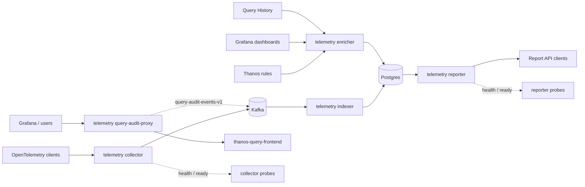
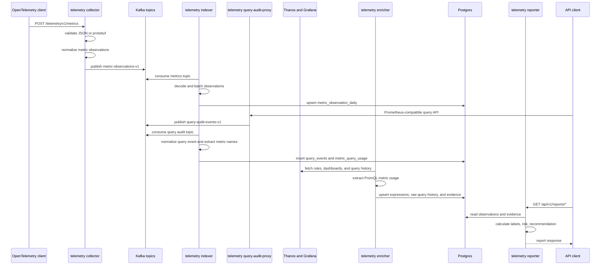

# anima Runtime Flow

anima produces metric usage reports by joining these signals from the telemetry estate:

- observed metrics received from OpenTelemetry traffic
- usage evidence extracted from PromQL in Thanos rules, Grafana dashboards, and Query History
- live Thanos query usage captured by the query audit proxy

The final report is served by `telemetry reporter` under `/api/v1/reports`. It classifies metrics by risk and recommendation, such as `keep`, `keep_or_review_aggregation`, `review_dashboard_usage`, `review_recent_query_usage`, `drop_candidate`, and `review`.

## Commands

- [collector](collector.md): receives OpenTelemetry payloads and publishes telemetry to Kafka.
- [indexer](indexer.md): consumes normalized metric observations and query audit events.
- [enricher](enricher.md): extracts configured and actual PromQL usage evidence from Thanos and Grafana.
- [reporter](reporter.md): serves metric reports from Postgres.
- [query audit proxy](query-audit-proxy.md): proxies Thanos queries and publishes query audit events.
- [entity resolver](entity-resolver.md): resolves raw OTLP telemetry into Memgraph topology and Postgres health/change history.

All commands are registered under the root command in [`cmd/root.go`](../cmd/root.go). Runtime configuration is loaded from [`config.toml`](../config.toml) through [`internal/config/config.go`](../internal/config/config.go).

## Architecture

Postgres is the shared state boundary. The collector/indexer path records which metrics exist and how often they are observed. The enricher path records where those metrics are referenced. The query-audit path records which metrics are actively queried. The reporter combines those signals into summaries, metric detail rows, evidence lists, risk, and recommendations.

The persisted tables are defined in [`internal/storage/postgres/schema.go`](../internal/storage/postgres/schema.go):

- `metric_observation_daily`: daily metric observations produced by the indexer
- `metric_usage_expression_daily`: PromQL expressions discovered by the enricher
- `metric_usage_evidence_daily`: metric-level usage evidence derived from expressions
- `query_history_daily`: raw Query History extraction details
- `query_events`: raw Thanos query audit request metadata produced by the indexer
- `metric_query_usage`: per-metric live query usage produced from query audit events

## Sequence

## Runtime Inputs And Outputs

The collector accepts OpenTelemetry logs, metrics, and traces at `/telemetry/v1`. Only metrics are normalized into observation rows that the indexer stores for reporting. Logs and traces are validated and published to their configured Kafka topics, but they are not part of the current report calculation.

The query audit proxy publishes Prometheus-compatible query audit events to Kafka. The indexer consumes those events, stores request-level metadata, extracts metric names from PromQL, falls back to proxy-provided metric names when needed, and records live query usage per metric.

The enricher is independent of incoming telemetry. It looks at configured observability sources and discovers which metric names and labels are referenced by PromQL expressions. Query History adds actual recent usage, while rules and dashboards represent configured usage. Parse failures are logged as warnings and skipped so valid expressions can still be stored. Selector-only queries are stored, but they do not create metric-specific evidence until a concrete metric name can be extracted.

The reporter resolves a tenant and day, reads the configured lookback window, then joins observation rows with usage evidence and live query usage. The recommendation rules are implemented in [`reporter/service.go`](../reporter/service.go): alerts are critical keep signals, live Thanos query usage in the last 30 days is a high-risk keep signal, recording rules are high-risk aggregation-review signals, dashboards are medium-risk dashboard-review signals, query-history usage is medium-risk recent-usage review, protected platform metrics override drop candidates, and otherwise unused metrics become drop candidates.
