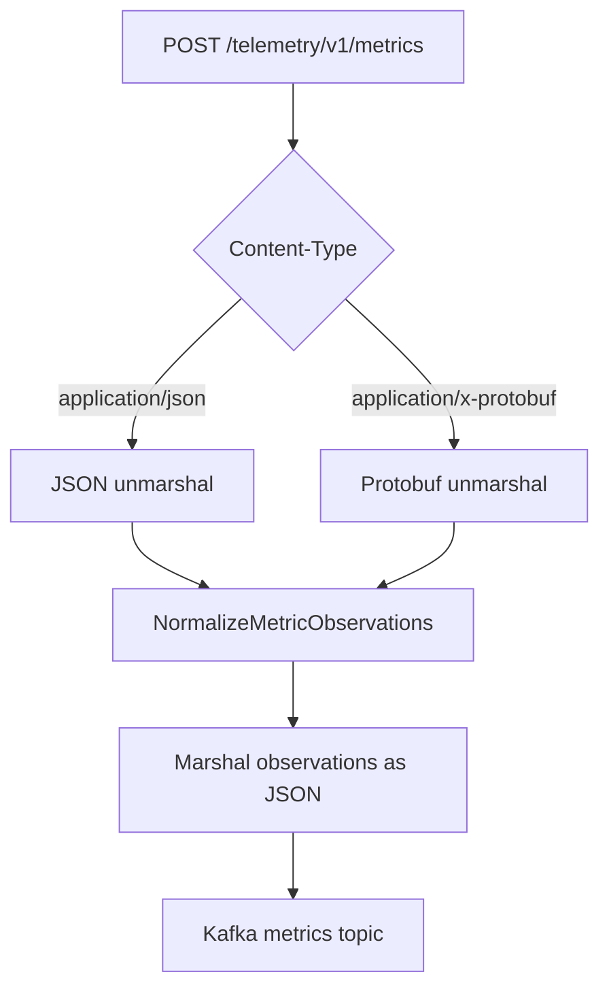

# collector

`collector` starts the HTTP ingress service for OpenTelemetry payloads. The command entrypoint is [`cmd/collector.go`](../cmd/collector.go), and the HTTP server is assembled in [`collector/collector.go`](../collector/collector.go).

## What It Does

- Exposes `/healthz` and `/readyz`.
- Accepts OpenTelemetry logs, metrics, and traces under `/telemetry/v1`.
- Supports `application/json` and `application/x-protobuf` request bodies.
- Validates payloads using the matching OpenTelemetry unmarshaler.
- Publishes accepted payloads to Kafka through [`internal/producer`](../internal/producer/producer.go).
- Normalizes metric payloads into metric observations before publishing them.

## Endpoints

| Endpoint                     | Purpose                                | Output path              |
| ---------------------------- | -------------------------------------- | ------------------------ |
| `GET /healthz`               | Process health check                   | local response only      |
| `GET /readyz`                | Kafka producer readiness check         | local response only      |
| `POST /telemetry/v1/logs`    | Validate log payloads                  | configured logs topic    |
| `POST /telemetry/v1/metrics` | Validate and normalize metric payloads | configured metrics topic |
| `POST /telemetry/v1/traces`  | Validate trace payloads                | configured traces topic  |

The route registration lives in [`collector/collector.go`](../collector/collector.go). Request handling lives in [`collector/handlers.go`](../collector/handlers.go).

## Metric Normalization

Metrics are converted into a compact list of observations by [`collector/normalize.go`](../collector/normalize.go). Each observation captures the metric name, metric type, base metric name, unit, description, label keys, selected resource labels, tenant, cluster, namespace, service, source, and observation time.

The collector deduplicates observations within a request by a stable hash of tenant, cluster, namespace, service, metric name, metric type, and label keys. When duplicate observations are found, their label keys are merged.

## Configuration

The collector uses these config sections from [`config.toml`](../config.toml):

- `[collector]`: listen address, port, and telemetry topic names
- `[producer]`: Kafka broker settings
- `[logger]`: log level inherited from the root command

The current default topics are:

- `metric-observations-v1`
- `traces-observations-v1`
- `logs-observations-v1`

## Source References

- Command: [`cmd/collector.go`](../cmd/collector.go)
- Server and routes: [`collector/collector.go`](../collector/collector.go)
- Request handlers: [`collector/handlers.go`](../collector/handlers.go)
- Metric normalization: [`collector/normalize.go`](../collector/normalize.go)
- Producer interface: [`internal/producer/producer.go`](../internal/producer/producer.go)
