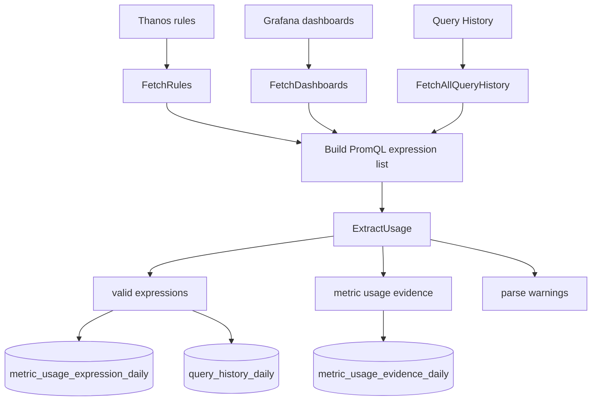
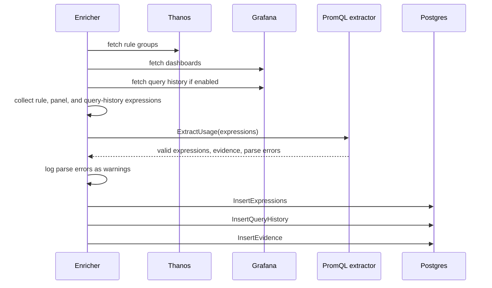

# enricher

`enricher` discovers metric usage by reading PromQL expressions from Thanos rules, Grafana dashboards, and Query History. The command entrypoint is [`cmd/enricher.go`](../cmd/enricher.go), and the enrichment flow is implemented in [`enricher/enricher.go`](../enricher/enricher.go).

## What It Does

- Connects to Postgres and initializes the anima schema.
- Fetches rule groups from the configured Thanos rules source.
- Fetches dashboard documents from the configured Grafana source.
- Fetches recent Query History for the configured datasource when enabled.
- Extracts PromQL expressions from alerting rules, recording rules, dashboard panels, and query history entries.
- Parses expressions to discover referenced metrics and labels.
- Stores valid expressions in `metric_usage_expression_daily`.
- Stores raw query-history extraction details in `query_history_daily`.
- Stores derived metric evidence in `metric_usage_evidence_daily`.
- Marks query-history evidence with `is_query_history`, `last_queried_at`, `query_history_count`, and `queried_at`.
- Logs invalid PromQL expressions as warnings and skips them.
- Stores selector-only query-history expressions, but does not create metric-specific evidence unless a concrete metric name can be extracted.

## Data Flow

Thanos and Grafana clients live in [`internal/sources/thanos`](../internal/sources/thanos/thanos.go) and [`internal/sources/grafana`](../internal/sources/grafana/grafana.go). PromQL extraction lives in [`internal/usage/promql_extract.go`](../internal/usage/promql_extract.go).

## Source Types

The enricher creates usage evidence from four source categories:

| Source            | Meaning                                                            |
| ----------------- | ------------------------------------------------------------------ |
| Thanos alert      | A metric appears in an alerting rule.                              |
| Thanos rule       | A metric appears in a non-alerting rule, usually a recording rule. |
| Grafana dashboard | A metric appears in a dashboard panel target.                      |
| Query History     | A metric appears in a recently executed Prometheus query.          |

These source types become report signals such as `used_in_alerts`, `used_in_recording_rules`, `used_in_dashboards`, and `used_in_query_history`.

## Sequence

## Configuration

The enricher uses these config sections from [`config.toml`](../config.toml):

- `[sources]`: tenant, Thanos rules URL, Grafana URL, Grafana token, Grafana timeout, and query-history settings
- `[store]`: Postgres connection
- `[logger]`: log level inherited from the root command

`GRAFANA_TOKEN` can override `sources.grafana_token`; this behavior is defined in [`internal/config/config.go`](../internal/config/config.go).

Query-history settings are TOML-backed and validated in [`internal/config/config.go`](../internal/config/config.go):

| Config key                             | Default     | Meaning                                     |
| -------------------------------------- | ----------- | ------------------------------------------- |
| `sources.grafana_timeout_seconds`      | `30`        | Timeout for Grafana API calls.              |
| `sources.query_history_enabled`        | `true`      | Enables query-history ingestion.            |
| `sources.query_history_datasource_uid` | `thanos`    | Grafana datasource UID to fetch and accept. |
| `sources.query_history_lookback_hours` | `24`        | UTC lookback window for each enricher run.  |
| `sources.query_history_limit`          | `100`       | Page size for `/api/query-history`.         |
| `sources.query_history_sort`           | `time-desc` | Sort order passed to Grafana.               |
| `sources.query_history_max_pages`      | `100`       | Safety cap for pagination.                  |

## Source References

- Command: [`cmd/enricher.go`](../cmd/enricher.go)
- Enrichment flow: [`enricher/enricher.go`](../enricher/enricher.go)
- Thanos source client: [`internal/sources/thanos/thanos.go`](../internal/sources/thanos/thanos.go)
- Grafana source client: [`internal/sources/grafana/grafana.go`](../internal/sources/grafana/grafana.go)
- PromQL extraction: [`internal/usage/promql_extract.go`](../internal/usage/promql_extract.go)
- Storage schema and upserts: [`internal/storage/postgres/schema.go`](../internal/storage/postgres/schema.go)
