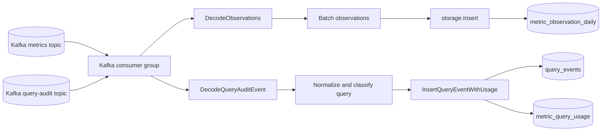
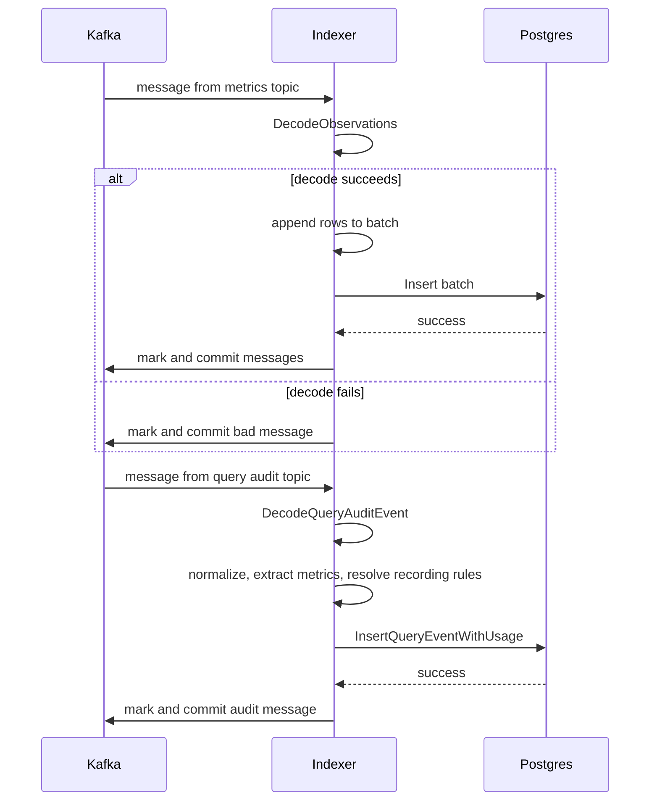

# indexer

`indexer` consumes normalized metric observations and query audit events from Kafka, then stores observation and query-usage records in Postgres. The command entrypoint is [`cmd/indexer.go`](../cmd/indexer.go), and the service setup is in [`indexer/indexer.go`](../indexer/indexer.go).

## What It Does

- Connects to Postgres and initializes the anima schema.
- Creates one Kafka consumer group for the configured metrics and query-audit topics.
- Decodes normalized metric observation messages.
- Batches metric observation rows by size or time.
- Upserts daily observation records into `metric_observation_daily`.
- Decodes query audit events from the query audit proxy.
- Stores one `query_events` row per audited request.
- Extracts PromQL metric names and stores per-metric rows in `metric_query_usage`.
- Resolves recording-rule metrics through existing usage evidence when available.
- Marks Kafka messages only after a successful database write.
- Skips malformed messages after logging the decode failure.

## Data Flow

The indexer reads `collector.metrics_topic` and `query_audit_proxy.audit_topic`. With the default config in [`config.toml`](../config.toml), these are `metric-observations-v1` and `query-audit-events-v1`.

## Batching And Writes

Metric observation batching is handled by [`indexer/handler.go`](../indexer/handler.go):

- `consumer.batch_size` controls how many observation rows trigger a flush.
- `consumer.flush_interval_seconds` controls the periodic flush interval.
- Defaults are applied in code if invalid values reach the handler.

Query audit events are processed one Kafka message at a time. The event row and all derived metric usage rows are inserted in one transaction, so the raw audit request and metric-level usage stay consistent.

Database writes use the storage layer in [`internal/storage`](../internal/storage/storage.go). The Postgres table definitions and insert statements are defined in [`internal/storage/postgres/schema.go`](../internal/storage/postgres/schema.go).

`metric_observation_daily` stores one daily row per tenant, cluster, and metric name. Upserts preserve earliest `first_seen_at`, latest `last_seen_at`, increment `observation_count`, and merge observed label/resource-label keys.

`query_events` stores request-level audit data such as `observed_at`, tenant, path, method, usage kind, query hash, optional raw PromQL, dashboard/panel metadata, status, duration, and parseable Prometheus time parameters.

`metric_query_usage` stores one row per metric referenced by a query execution. Rows are intentionally not deduplicated because repeated dashboard refreshes are usage evidence.

## Query Audit Behavior

The indexer reuses the event shape published by [`queryaudit`](../queryaudit/model.go). It treats `org_id` as the tenant, uses `timestamp` as `observed_at`, and falls back to the Kafka timestamp only when the event timestamp is missing.

Metric extraction prefers the PromQL text in `query`. If `query` is absent, the indexer inspects `raw_query` only to parse the `query=` URL parameter; it does not persist URL query strings as raw PromQL. If parsing fails or no query text is available, `extracted_metrics` from the proxy is used as fallback.

The indexer classifies audit events into usage kinds such as `direct_query`, `range_query`, `dashboard_query`, and `dashboard_range_query`. Only these query-like events create `metric_query_usage` rows; lookup endpoints such as `/api/v1/series` and `/api/v1/labels` are still stored in `query_events`.

When a queried metric is a recording rule and existing enrichment evidence can resolve its underlying metrics, the indexer writes the recording rule query row and additional indirect rows with `usage_kind = recording_rule_query`.

## Decode Behavior

The collector publishes JSON arrays of metric observations. The indexer decodes those messages through [`indexer/decoder.go`](../indexer/decoder.go), converts them into storage rows, and uses the message timestamp when needed by the decoder.

Malformed messages are logged, marked, and committed so a single bad payload does not block the consumer group.

Malformed query audit JSON is also logged, marked, and committed. Query audit storage failures are not marked, so Kafka can retry them. Invalid Prometheus time parameters are logged and stored as null fields without failing the event.

## Configuration

The indexer uses these config sections:

- `[consumer]`: Kafka brokers, consumer group, batch size, flush interval
- `[collector]`: metrics topic name
- `[query_audit_proxy]`: audit topic name
- `[store]`: Postgres connection
- `[logger]`: log level inherited from the root command

## Source References

- Command: [`cmd/indexer.go`](../cmd/indexer.go)
- Service setup: [`indexer/indexer.go`](../indexer/indexer.go)
- Kafka handler: [`indexer/handler.go`](../indexer/handler.go)
- Decoder: [`indexer/decoder.go`](../indexer/decoder.go)
- Query audit normalization: [`indexer/query_audit.go`](../indexer/query_audit.go)
- PromQL metric extraction: [`internal/usage/promql_extract.go`](../internal/usage/promql_extract.go)
- Storage schema and upserts: [`internal/storage/postgres/schema.go`](../internal/storage/postgres/schema.go)
