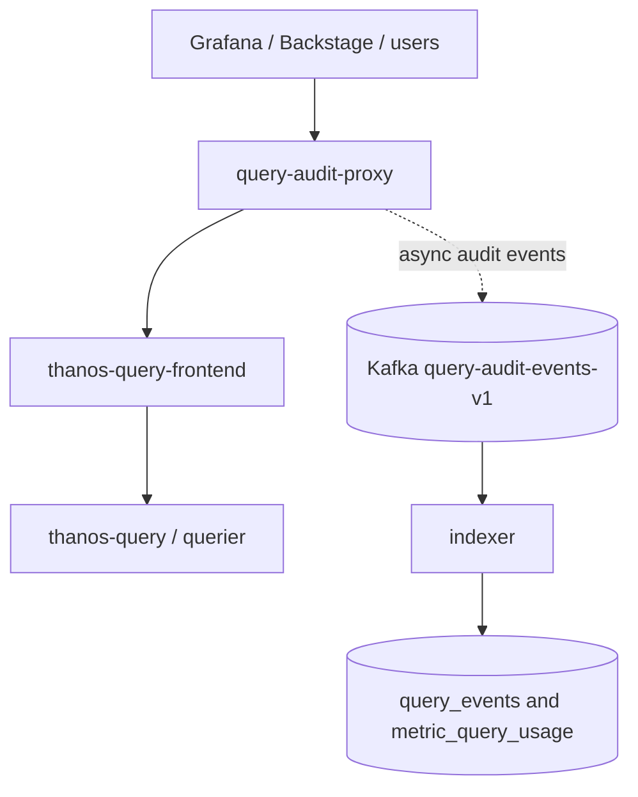

# query audit proxy

`query-audit-proxy` starts a transparent HTTP reverse proxy for Prometheus-compatible query APIs. It sits in front of `thanos-query-frontend`, forwards requests unchanged, and publishes query audit events to Kafka in the background.

## What It Does

- Proxies all HTTP requests to the configured upstream.
- Audits Prometheus API requests under `/api/v1`.
- Supports query parameters from `GET` requests and form parameters from `application/x-www-form-urlencoded` `POST` requests.
- Restores `POST` bodies before forwarding them upstream.
- Captures response status, request duration, caller headers, query hash, and extracted PromQL metric names.
- Publishes audit events asynchronously to Kafka.
- Drops audit events when the queue is full instead of delaying or failing queries.

## Topology



## Downstream Ingestion

The proxy publishes audit events to the topic configured by `query_audit_proxy.audit_topic`. The indexer consumes the same topic, stores request-level rows in `query_events`, extracts referenced metric names, and stores per-metric query usage rows in `metric_query_usage`.

When `log_raw_query = false`, the proxy omits the plain PromQL query. The indexer can still use `raw_query` to inspect the HTTP `query=` parameter for extraction, but it does not persist URL query strings as raw PromQL.

## Configuration

The proxy is configured from `config.toml`:

```toml
[query_audit_proxy]
address = "0.0.0.0"
port = 8080
upstream = "http://thanos-query-frontend.monitoring.svc.cluster.local:9090"
log_raw_query = false
event_buffer_size = 10000
audit_topic = "query-audit-events-v1"
```

Kafka brokers come from `[producer].brokers`, using the same producer implementation as the collector.

## Audit Privacy

Raw PromQL text is omitted by default. Audit events always include `query_hash` when a query is present, and include `query` only when `log_raw_query = true`.

## Failure Behavior

Audit publishing is fail-open. Kafka publish errors are logged by the background worker, and a full event queue increments the dropped-event counter and drops the event. Neither condition changes the upstream request or response.
