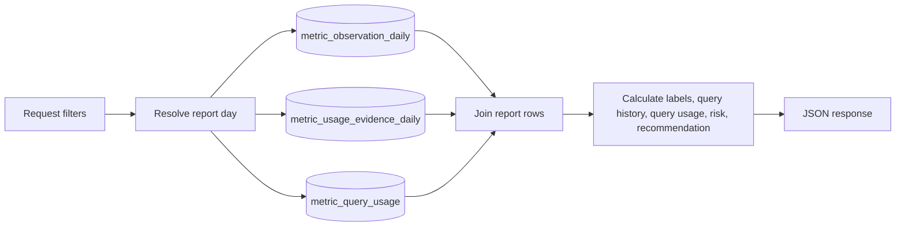
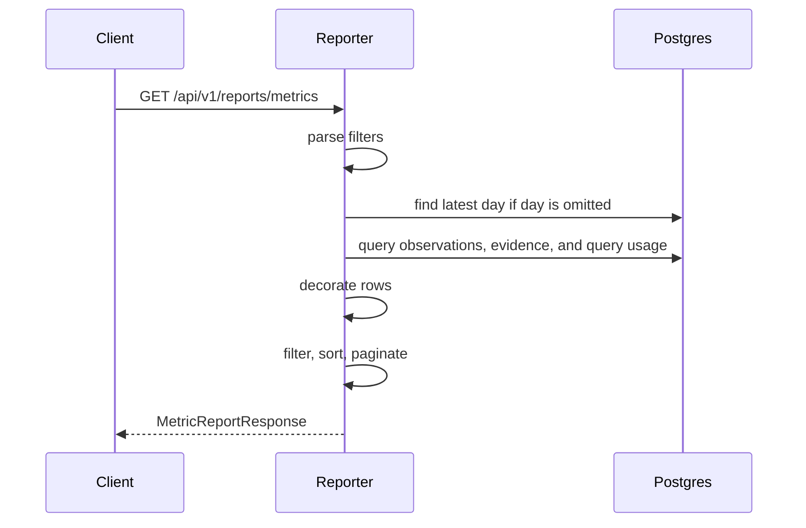

# reporter

`reporter` serves the final metric usage report API. The command entrypoint is [`cmd/reporter.go`](../cmd/reporter.go), and the service setup is in [`reporter/reporter.go`](../reporter/reporter.go).

## What It Does

- Starts an HTTP server for report clients.
- Exposes `/healthz` and `/readyz`.
- Reads metric observations from `metric_observation_daily`.
- Reads usage evidence from `metric_usage_evidence_daily`.
- Reads query-audit usage from `metric_query_usage`.
- Joins observations and evidence over a tenant/day lookback window.
- Aggregates configured usage, query-history usage, and live Thanos query-audit usage.
- Calculates unused labels, query-history fields, query-usage summaries, risk, recommendation, and summary totals.
- Returns summary, list, detail, and evidence responses under `/api/v1/reports`.

## Endpoints

Routes are registered in [`reporter/router.go`](../reporter/router.go).

| Endpoint                                            | Purpose                                   |
| --------------------------------------------------- | ----------------------------------------- |
| `GET /healthz`                                      | Process health check                      |
| `GET /readyz`                                       | Postgres readiness check                  |
| `GET /api/v1/reports/summary`                       | Aggregate report totals                   |
| `GET /api/v1/reports/metrics`                       | List metrics with risk and recommendation |
| `GET /api/v1/reports/metrics/:metric_name`          | Return one metric report row              |
| `GET /api/v1/reports/metrics/:metric_name/evidence` | Return PromQL evidence for one metric     |

## Report Pipeline

The repository queries are implemented in [`reporter/repository.go`](../reporter/repository.go). Response shapes are defined in [`reporter/model.go`](../reporter/model.go). Request parsing, filtering, sorting, pagination, risk, and recommendation logic live in [`reporter/service.go`](../reporter/service.go).

## Filters

The report API accepts these query parameters:

| Parameter                 | Meaning                                                                                    |
| ------------------------- | ------------------------------------------------------------------------------------------ |
| `tenant`                  | Tenant to report on. Required unless a default tenant is configured.                       |
| `day`                     | Report end day in `YYYY-MM-DD`; defaults to latest observed day for the tenant.            |
| `lookback_days`           | Number of days included in the report window.                                              |
| `cluster`                 | Exact cluster filter.                                                                      |
| `metric_name`             | Metric-name search for list responses.                                                     |
| `recommendation`          | Filter by calculated recommendation.                                                       |
| `risk`                    | Filter by calculated risk.                                                                 |
| `used_in_alerts`          | Filter by alert usage signal.                                                              |
| `used_in_recording_rules` | Filter by recording-rule usage signal.                                                     |
| `used_in_dashboards`      | Filter by dashboard usage signal.                                                          |
| `used_in_query_history`   | Filter by Query History usage signal.                                                      |
| `queried_in_last_days`    | Number of days used for query-history usage; defaults to `lookback_days`.                  |
| `source_type`             | Evidence endpoint filter, for example `query_history`.                                     |
| `unused_only`             | Return only metrics with no usage evidence.                                                |
| `drop_candidates_only`    | Return only metrics recommended as drop candidates; recently queried metrics are excluded. |
| `sort`                    | Sort field.                                                                                |
| `order`                   | `asc` or `desc`.                                                                           |
| `limit`                   | Page size, capped by config.                                                               |
| `offset`                  | Page offset.                                                                               |

Allowed sort fields are `metric_name`, `last_seen_at`, `last_queried_at`, `observation_count`, `query_history_count`, `usage_evidence_count`, `risk`, and `recommendation`.

## Query-History Fields

Metric report rows include actual query usage over the query-history window:

| Field                   | Meaning                                                           |
| ----------------------- | ----------------------------------------------------------------- |
| `used_in_query_history` | True when query-history evidence exists for the metric.           |
| `last_queried_at`       | Most recent query-history timestamp for the metric.               |
| `query_history_count`   | Count of query-history evidence rows in the query-history window. |
| `queried_at`            | Distinct query-history timestamps, newest first.                  |
| `queried_at_truncated`  | True when `queried_at` was capped by config.                      |

Evidence responses also include `is_query_history`, `last_queried_at`, `query_history_count`, and `queried_at`. Use `source_type=query_history` on `GET /api/v1/reports/metrics/:metric_name/evidence` to return only query-history evidence rows.

## Query-Usage Fields

Metric report rows also include live Thanos query-audit usage under a nested `query_usage` object. These fields are derived from `metric_query_usage` and do not expose raw PromQL:

| Field                                      | Meaning                                                 |
| ------------------------------------------ | ------------------------------------------------------- |
| `query_usage.last_queried_at`              | Most recent query-audit timestamp for the metric.       |
| `query_usage.query_count_24h`              | Query usage rows observed in the last 24 hours.         |
| `query_usage.query_count_7d`               | Query usage rows observed in the last 7 days.           |
| `query_usage.query_count_30d`              | Query usage rows observed in the last 30 days.          |
| `query_usage.distinct_query_count_30d`     | Distinct non-empty query hashes in the last 30 days.    |
| `query_usage.distinct_dashboard_count_30d` | Distinct dashboard UIDs in the last 30 days.            |
| `query_usage.direct_query_count_30d`       | Direct query-like usage rows in the last 30 days.       |
| `query_usage.indirect_query_count_30d`     | Indirect recording-rule usage rows in the last 30 days. |
| `query_usage.was_queried_in_last_30d`      | True when `query_count_30d` is greater than zero.       |

## Risk And Recommendation

The reporter calculates risk and recommendation after loading raw rows:

| Signal                                | Risk       | Recommendation               |
| ------------------------------------- | ---------- | ---------------------------- |
| Used in alerts                        | `critical` | `keep`                       |
| Queried in Thanos in the last 30 days | `high`     | `keep`                       |
| Used in recording rules               | `high`     | `keep_or_review_aggregation` |
| Used in dashboards                    | `medium`   | `review_dashboard_usage`     |
| Used in query history                 | `medium`   | `review_recent_query_usage`  |
| Protected platform metric             | `unknown`  | `review`                     |
| No usage evidence                     | `low`      | `drop_candidate`             |

Protected platform metrics include names matching `up`, `scrape_*`, `prometheus_*`, `thanos_*`, `grafana_*`, `alertmanager_*`, `go_*`, and `process_*`. This protection only overrides metrics that would otherwise be `drop_candidate`. Metrics queried in Thanos in the last 30 days are not drop candidates.

## Sequence

## Configuration

The reporter uses these config sections from [`config.toml`](../config.toml):

- `[reporter]`: listen address, port, default tenant, default lookback, default limit, max limit, max queried-at entries
- `[store]`: Postgres connection
- `[logger]`: log level inherited from the root command

`reporter.max_queried_at_entries` caps the number of timestamps returned in each row's `queried_at` array. The default is `50`.

The following environment variables can override reporter defaults through [`internal/config/config.go`](../internal/config/config.go):

- `REPORTER_ADDRESS`
- `REPORTER_PORT`
- `REPORT_DEFAULT_TENANT`
- `REPORT_DEFAULT_LOOKBACK_DAYS`
- `REPORT_DEFAULT_LIMIT`
- `REPORT_MAX_LIMIT`

## Source References

- Command: [`cmd/reporter.go`](../cmd/reporter.go)
- Server setup: [`reporter/reporter.go`](../reporter/reporter.go)
- Routes and handlers: [`reporter/router.go`](../reporter/router.go), [`reporter/handlers.go`](../reporter/handlers.go)
- Report service: [`reporter/service.go`](../reporter/service.go)
- Report queries: [`reporter/repository.go`](../reporter/repository.go)
- Response models: [`reporter/model.go`](../reporter/model.go)
